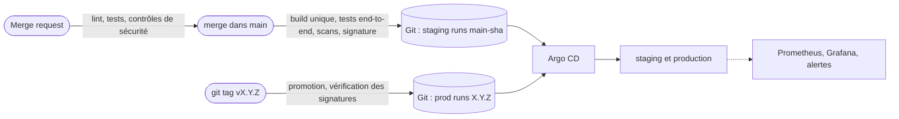

# Votely

[](README.md) [](README.fr.md) [](https://gitlab.com/StateOfFlowHunter/votely/-/pipelines) [](https://gitlab.com/StateOfFlowHunter/votely/-/pipelines) [](https://gitlab.com/StateOfFlowHunter/votely/-/tags)

> [!TIP]
> 🛠️ **Ceci est un projet vitrine DevOps** : l'application est volontairement simple, l'accent est
> mis sur la façon dont elle est construite, testée, sécurisée, livrée et exploitée.


Votely est une application de sondages légère : créer un sondage, le partager, recueillir des votes (un par compte) et suivre les résultats en direct.

📖 **[Lire l'étude de cas](https://vivienbarbeau.fr/votely/)** : le parcours du commit à la production, avec captures d'écran et vidéo.

## Du commit à la production



Le pipeline ne touche jamais au cluster : il écrit dans Git la version à déployer, et [Argo CD](docs/fr/GITOPS.md) l'applique. Chaque merge part en staging ; la production ne reçoit qu'un tag de version, une fois les signatures de ses images vérifiées. Revenir en arrière, c'est un `git revert`.

Le serveur AWS est créé à la demande et détruit entre deux sessions de travail (environ 6 USD par mois de coûts fixes) : les environnements ne sont donc pas en ligne en permanence, l'étude de cas les montre en fonctionnement.

## Stack

| Couche | Technologie |
|---|---|
| Frontend | React 19 · TypeScript · Vite · TanStack Query |
| Backend | Python 3.12 · FastAPI · SQLAlchemy 2 · Alembic |
| Base de données | PostgreSQL 16 |
| Conteneurs | Images Docker multi-étapes · nginx · Docker Compose |
| Tests | pytest · Vitest · Testing Library · MSW · Playwright |
| CI/CD | GitLab CI · gitleaks · Semgrep · Trivy · crane |
| Kubernetes | Charts Helm · ingress Traefik · kind (cluster local) · k3s (AWS) |
| Infrastructure | Terraform · AWS (EC2, S3, KMS, Systems Manager) |
| GitOps | Argo CD · Sealed Secrets · cert-manager |
| Chaîne d'approvisionnement | Cosign · AWS KMS · SBOM CycloneDX |
| Observabilité | Prometheus · Grafana · Alertmanager |

## Organisation du dépôt

```
.
├── .gitlab/ci/       # Pipeline CI, un fichier par composant
├── backend/          # API REST (FastAPI)
├── deploy/           # Charts Helm, applications Argo CD, environnements, plateforme, scripts
├── docs/             # Documentation technique (en/, fr/)
├── e2e/              # Tests end-to-end (Playwright)
├── frontend/         # Application web (React)
├── infra/terraform/  # AWS : ressources permanentes (bootstrap) et serveur jetable
├── compose.yaml      # Stack complète (Docker Compose)
└── compose.e2e.yaml  # Stack jetable pour les tests end-to-end
```

## Démarrage

### Lancer toute la stack avec Docker

```bash
cp .env.example .env          # puis définir un mot de passe de base et un secret JWT (openssl rand -hex 32)
docker compose up --build     # http://localhost:8080
```

### Lancer sur Kubernetes (cluster local)

Prérequis : Docker, [mise](https://mise.jdx.dev/).

```bash
mise install                  # versions de kind, kubectl et Helm fixées dans .mise.toml
deploy/kind/up.sh             # http://votely.localhost (images publiées par la CI)
deploy/kind/down.sh           # supprimer le cluster
```

### Développement local

Prérequis : Docker, [mise](https://mise.jdx.dev/) (installe Python 3.12, uv, Node.js 24 et les outils Kubernetes).

```bash
mise install                  # versions des outils fixées dans .mise.toml
cp .env.example .env          # puis définir un mot de passe local et un secret JWT (openssl rand -hex 32)
docker compose up -d db       # PostgreSQL sur localhost:5432

cd backend
uv sync
set -a && . ../.env && set +a
uv run alembic upgrade head   # création du schéma
uv run uvicorn app.main:app --reload
```

Dans un autre terminal :

```bash
cd frontend
npm ci
npm run dev                   # http://localhost:5173 (redirige /api vers le backend)
```

- Application : http://localhost:5173
- Documentation de l'API : http://localhost:8000/docs
- Liveness : `GET /healthz` · Readiness : `GET /readyz`

## Développement

```bash
cd backend
uv run pytest           # tests
uv run ruff check .     # lint
uv run ruff format .    # formatage

cd ../frontend
npm test                # tests
npm run lint            # lint
npm run format          # formatage

cd ../e2e
npm run stack:up        # stack jetable pour les tests (http://localhost:8081)
npm test                # tests end-to-end
npm run test:ui         # les explorer dans l'interface Playwright
npm run test:headed     # les regarder en direct dans un navigateur, au ralenti
npm run test:debug      # les exécuter action par action
npm run stack:down      # supprime la stack de test et ses données

uvx pre-commit install  # hooks git (lint + détection de secrets)
```

## Documentation

- [Backend](docs/fr/BACK.md) : architecture, authentification, API, modèle de données, migrations, tests
- [Frontend](docs/fr/FRONT.md) : architecture, communication avec l'API, expérience utilisateur, tests
- [Conteneurs](docs/fr/CONTAINERS.md) : images, stack Docker Compose, durcissement, scans
- [Tests](docs/fr/TESTS.md) : stratégie de test, tests end-to-end, comment les regarder
- [Intégration continue](docs/fr/CI.md) : organisation du pipeline, règles, stages, versions
- [Kubernetes](docs/fr/KUBERNETES.md) : charts Helm, cluster local, serveur AWS en HTTPS, migrations, sécurité
- [GitOps](docs/fr/GITOPS.md) : Argo CD, staging et production, déployer, revenir en arrière, secrets chiffrés
- [Observabilité](docs/fr/OBSERVABILITY.md) : Prometheus, Grafana, Alertmanager, accès
- [Infrastructure](docs/fr/INFRA.md) : accès AWS, state Terraform, réseau et serveur, accès CI, clé de signature, coûts

## Licence

[MIT](LICENSE)
